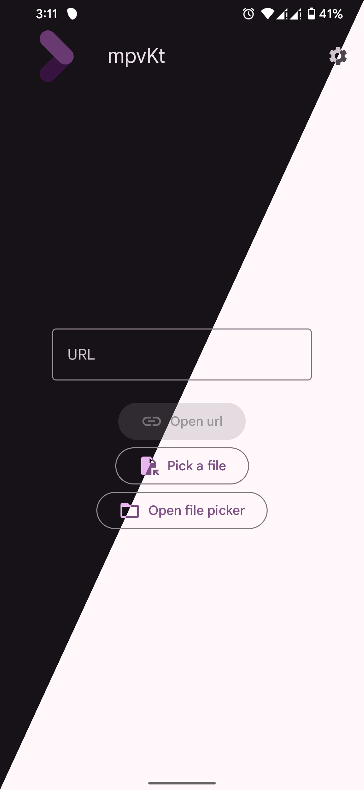
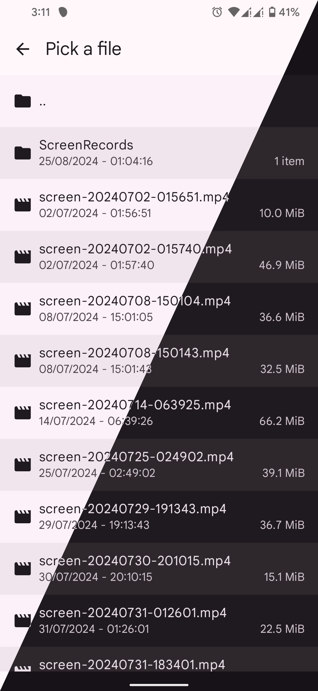
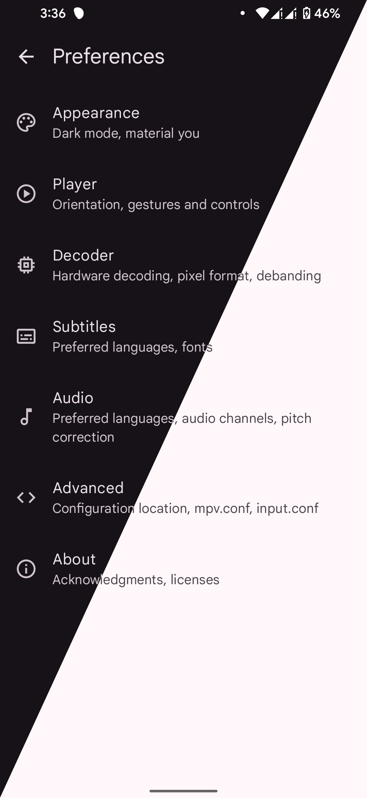
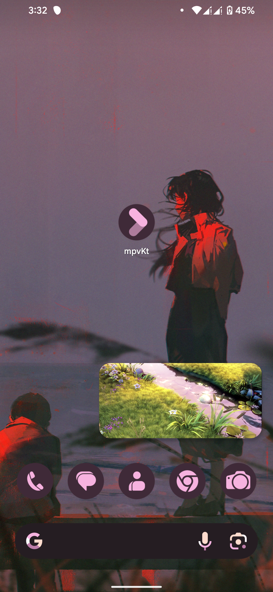
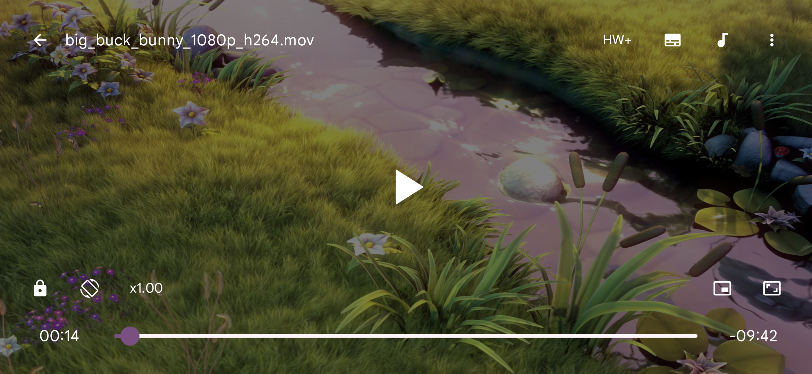
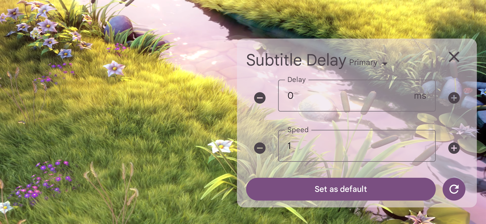
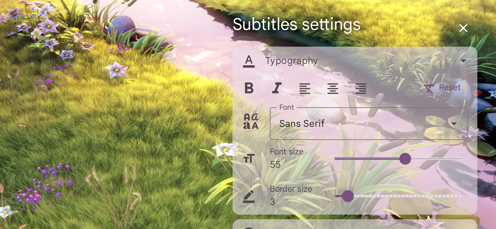
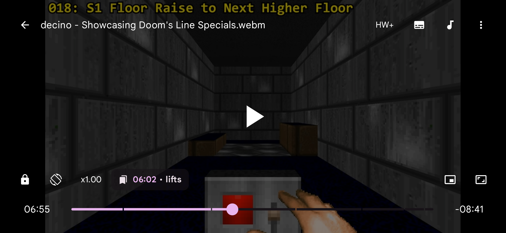

#  unfold-mpv
A media player for Android based on mpv-android aiming to provide a *nicer* user interface over the original.

This is my personal fork of mpvKt by abdallahmehiz. It is public and you are welcome to use it, but it comes without any guarantees or support. Licensed under Apache 2.0.

## Additional features
- Nicer player UI
- Better playback history implementation
- Easier customization
- Sleep timer, Speed presets
- Smoother PiP

## Showcase

   
 
 

## Acknowledgments
- mpv-android for the base mpv library to use for this project.